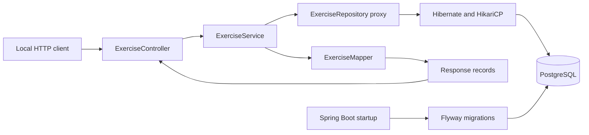
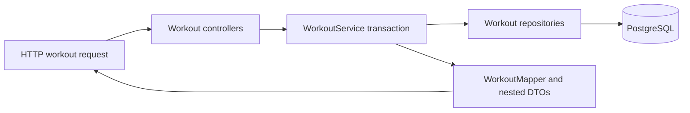

# Architecture

## Implemented through Milestone 3

A JVM process runs Spring Boot, embedded Tomcat, Web MVC, Actuator, Spring Data JPA/Hibernate, JDBC/HikariCP and Flyway. PostgreSQL runs in this project's separate Compose stack. Configuration remains environment-based and local-only.

## Responsibilities and request lifecycle

- `controller`: HTTP route binding, request validation, status codes and creation Location header.
- `service`: read/write transaction boundaries and built-in exercise protection.
- `repository`: a Spring Data interface for JPA persistence and bounded name search. Spring provides its implementation through a runtime proxy; no hidden generated business logic is used.
- `entity`: the managed `Exercise` class and explicit SQL column mappings.
- `dto`: immutable input/output records and the pagination envelope. JPA entities never cross the HTTP boundary.
- `mapper`: plain explicit entity-to-response conversion, without a mapping dependency.
- `exception`: domain failures and centralized ProblemDetail responses.

A POST body deserializes into `ExerciseRequest`, whose compact constructor normalizes whitespace. Bean Validation checks the record. The controller invokes the service through Spring's transaction proxy; the service creates a custom entity and persists/flushed it through the repository. PostgreSQL assigns the ID and enforces constraints. The mapper creates an immutable response DTO while the transaction is active; the controller returns 201 plus Location.

For PUT, the service loads a managed entity, rejects built-in origin, updates its fields and flushes. Hibernate dirty checking writes the changes at the transaction boundary. A failed database constraint rolls the whole transaction back. Read-only service methods wrap reads; write methods explicitly override the class-level read-only default. OSIV is disabled, so persistence work must finish inside the service transaction.

## Startup, health and logs

Startup begins in `PunttiUrpoApplication`. Flyway applies V1 (exercise schema), V2 (historical seeds), V3 (ten requested exercise names) and V4 (workout domain); Hibernate then validates its mappings against the migrated schema. It never creates or updates tables. Later startups validate history instead of reseeding.

Actuator performs aggregate dependency checks and returns only UP/DOWN status. Database outages after startup produce 503 while the JVM remains alive; initial migration/connection failures stop startup. JDBC and pool timeouts bound stalls. Operational details remain private. Console logs use Spring Boot's ECS JSON format, and unexpected API errors are logged centrally without leaking internals in responses.

## Tests and deliberate limits

Unit tests cover request normalization/validation boundaries and service rules using Mockito repository doubles. The subclass mock maker avoids runtime Java-agent attachment; it cannot mock final classes, which these tests do not require. Integration tests use full HTTP servers and real disposable PostgreSQL containers for migrations, constraints, rollback, search, validation, seed protection, health outage/recovery and OpenAPI/UI compatibility.

Authentication, ownership, derived strength metrics and frontend UI remain future milestones. Workout references and deletion boundaries are implemented as documented below. Metadata remains free text; search uses database substring matching rather than a search engine. See the decision log for trade-offs.

## Workout domain and nested reads

WorkoutController handles workout CRUD, summary pagination and exercise append. WorkoutEntryController handles logged-exercise/set reads, replacements and deletes. WorkoutService owns use cases/transactions, uses dedicated repositories and maps responses before leaving the transaction. No entities are returned over HTTP.

Workout detail loads the parent, its logged exercises with catalogue references through an entity graph, and the workout's sets once. It groups sets by logged-exercise ID in memory; this avoids one SQL set query per entry. Summary pagination does not load children. Single-entry reads query only that entry's sets.

The JPA relationships are required, lazy and unidirectional: WorkoutExercise → Workout/Exercise and WorkoutSet → WorkoutExercise. There are no bidirectional collections to serialize or keep synchronized. PostgreSQL foreign keys own cascades: deleting a workout removes its logged exercises/sets, deleting a logged exercise removes its sets, and referenced catalogue deletion is restricted. Database integration tests prove these effects across separate requests and check unrelated data remains.

Cross-field rules live in WorkoutService (time range, completed-set requirements, RPE half-step); scalar bounds live on DTOs, and SQL repeats critical integrity checks. BigDecimal and explicit numeric scale preserve decimal values. RPE is recorded but no RIR/e1RM calculation occurs until Milestone 4. Date-only training dates use LocalDate, while optional timestamps use Instant. Set types use a string-persisted enum. See DATABASE.md for precision, foreign keys and ordering behavior.
