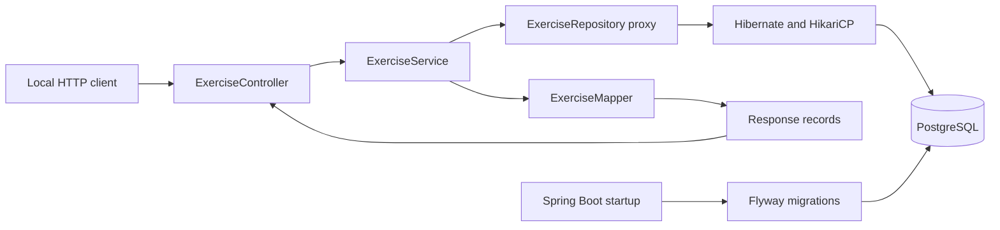
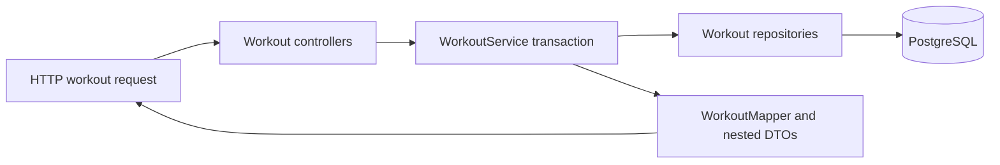
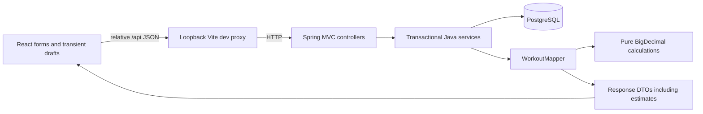

# Architecture

## Implemented through Milestone 5

A JVM process runs Spring Boot, embedded Tomcat, Web MVC, Actuator, Spring Data JPA/Hibernate, JDBC/HikariCP and Flyway. PostgreSQL runs in this project's separate Compose stack. Configuration remains environment-based and local-only.

## Responsibilities and request lifecycle

- `controller`: HTTP route binding, request validation, status codes and creation Location header.
- `service`: read/write transaction boundaries and built-in exercise protection.
- `repository`: a Spring Data interface for JPA persistence and bounded name search. Spring provides its implementation through a runtime proxy; no hidden generated business logic is used.
- `entity`: the managed `Exercise` class and explicit SQL column mappings.
- `dto`: immutable input/output records and the pagination envelope. JPA entities never cross the HTTP boundary.
- `mapper`: plain explicit entity-to-response conversion, without a mapping dependency.
- `exception`: domain failures and centralized ProblemDetail responses.

A POST body deserializes into `ExerciseRequest`, whose compact constructor normalizes whitespace. Bean Validation checks the record. The controller invokes the service through Spring's transaction proxy; the service creates a custom entity and persists/flushed it through the repository. PostgreSQL assigns the ID and enforces constraints. The mapper creates an immutable response DTO while the transaction is active; the controller returns 201 plus Location.

For PUT, the service loads a managed entity, rejects built-in origin, updates its fields and flushes. Hibernate dirty checking writes the changes at the transaction boundary. A failed database constraint rolls the whole transaction back. Read-only service methods wrap reads; write methods explicitly override the class-level read-only default. OSIV is disabled, so persistence work must finish inside the service transaction.

## Startup, health and logs

Startup begins in `PunttiUrpoApplication`. Flyway applies V1 (exercise schema), V2 (historical seeds), V3 (ten requested exercise names) V4 (workout domain) and V5 (Finnish built-in names); Hibernate then validates its mappings against the migrated schema. It never creates or updates tables. Later startups validate history instead of reseeding.

Actuator performs aggregate dependency checks and returns only UP/DOWN status. Database outages after startup produce 503 while the JVM remains alive; initial migration/connection failures stop startup. JDBC and pool timeouts bound stalls. Operational details remain private. Console logs use Spring Boot's ECS JSON format, and unexpected API errors are logged centrally without leaking internals in responses.

## Tests and deliberate limits

Unit tests cover request normalization/validation boundaries and service rules using Mockito repository doubles. The subclass mock maker avoids runtime Java-agent attachment; it cannot mock final classes, which these tests do not require. Integration tests use full HTTP servers and real disposable PostgreSQL containers for migrations, constraints, rollback, search, validation, seed protection, health outage/recovery and OpenAPI/UI compatibility.

Session authentication and account scoping are implemented; progression aggregation remains a future milestone. The React frontend is implemented as described below. Per-set RIR/repetition-based e1RM estimates are implemented in Milestone 4. Workout references and deletion boundaries are implemented as documented below. Metadata remains free text; search uses database substring matching rather than a search engine. See the decision log for trade-offs.

## Workout domain and nested reads

WorkoutController handles workout CRUD, summary pagination and exercise append. WorkoutEntryController handles logged-exercise/set reads, replacements and deletes. WorkoutService owns use cases/transactions, uses dedicated repositories and maps responses before leaving the transaction. No entities are returned over HTTP.

Workout detail loads the parent, its logged exercises with catalogue references through an entity graph, and the workout's sets once. It groups sets by logged-exercise ID in memory; this avoids one SQL set query per entry. Summary pagination does not load children. Single-entry reads query only that entry's sets.

The JPA relationships are required, lazy and unidirectional: WorkoutExercise → Workout/Exercise and WorkoutSet → WorkoutExercise. There are no bidirectional collections to serialize or keep synchronized. PostgreSQL foreign keys own cascades: deleting a workout removes its logged exercises/sets, deleting a logged exercise removes its sets, and referenced catalogue deletion is restricted. Database integration tests prove these effects across separate requests and check unrelated data remains.

Cross-field rules live in WorkoutService (time range, completed-set requirements, RPE half-step); scalar bounds live on DTOs, and SQL repeats critical integrity checks. BigDecimal and explicit numeric scale preserve decimal values. RPE is recorded and Milestone 4 derives approximate RIR/repetition-based e1RM through pure domain functions. Date-only training dates use LocalDate, while optional timestamps use Instant. Set types use a string-persisted enum. See DATABASE.md for precision, foreign keys and ordering behavior.

## Pure training calculations

`domain/TrainingCalculations` accepts scalar kg, repetitions, RPE and completed/working-set flags. It has no entity, repository or Spring dependency. `domain/SetEstimates` is an immutable result with nullable unavailable values and enum status/warnings. The result copies its warning list to prevent accidental mutation.

WorkoutMapper invokes the calculator while mapping each set. This single path serves creation, replacement, single reads and nested reads, avoiding divergent formulas or stale stored results. No metric columns, migration, backfill, external request or calculation-library dependency is introduced. Unit tests prove arithmetic and boundaries independently of Spring; integration tests prove serialization and current-data recalculation through real HTTP/PostgreSQL paths.

Estimated RIR uses 10 − RPE; e1RM uses Epley with the documented single-rep convention, final-only decimal rounding and explicit eligibility. These do not adjust repetitions using RIR. Future charts must preserve method labels and exclude unavailable values rather than treating null as zero. See CALCULATIONS.md for applicability and the separate unimplemented research candidate.

## React boundary (Milestone 5)

The proxy is development infrastructure, not a new domain layer. Production routing is deferred. React never connects to PostgreSQL and never reimplements strength calculations. `src/types.ts` describes JSON shapes, not managed entities; TypeScript types disappear at runtime. Server validation and database constraints remain authoritative.

`App.tsx` owns hash navigation, theme and unsaved/pending guards. `WorkoutList`, `ExerciseLibrary`, `WorkoutEditor` and `SetRow` separate screens and form ownership. `hooks.ts` cancels stale GET requests and tracks local pending/dirty forms. Each mutation merges only its changed subtree so another row's draft is preserved. Successful creates/deletes explicitly permit their follow-up navigation, avoiding a race with React's form cleanup; ordinary navigation still checks unsaved work. An initial exercise plus first set requires two API writes: partial success is displayed and recoverable rather than hidden or automatically repeated.

`api.ts` bounds requests at 15 seconds and translates ProblemDetail errors. Mutations are not automatically retried because a lost response does not prove the write failed. `utils.ts` handles locale text, dates and payloads; the Java calculation policy remains the sole source of estimates. See [FRONTEND.md](FRONTEND.md) for alternatives, concurrency/offline limits and test coverage.

## Two-account security boundary

`security/SecurityConfig` defines two manually configured BCrypt-backed principals through Spring Security; no account is created by HTTP. Its filter chain supplies form login/session fixation protection, CSRF and logout, JSON security errors, owner-only mutation/Swagger access, and authenticated data reads. `SessionController` returns masked CSRF tokens and current account metadata. `LoginRateLimitFilter` provides a bounded process-wide login budget without trusting forwarded client headers. Session cookies are HttpOnly/SameSite=Strict/Secure by default; local HTTP explicitly overrides Secure.

`CurrentAccount` reads the authenticated principal. WorkoutRepository scopes pages/workout IDs; nested repositories traverse workout ownership for entry/set IDs. Services validate access before loading response children or changing data. Exercise queries return built-ins plus owner-visible custom records. V6 backfills legacy data to owner and seeds one invented demo session. `owner_key` is a stable two-value key, not an externally supplied DTO field. Database checks limit allowed owners; application queries provide row access control. PostgreSQL row-level security is not enabled.

React `AuthGate` loads identity before mounting data screens, sends session-backed CSRF headers for writes, refreshes tokens after login/logout, and clears private UI on logout/account change. An expired session hides the mounted App behind reauthentication so same-account unsaved drafts can survive; no write is automatically retried. Different accounts remount App. Demo UI disables/hides mutation controls, but actual enforcement is in Spring Security and account-scoped repository access.

The requested two accounts use one application/database with explicit row scoping. This differs from the earlier suggested separate deployment/database demo: it reduces local/NUC process overhead, but both accounts share the service/database blast radius. Separate deployments remain a stronger future deployment option. See AUTHENTICATION.md for limits and verification.
