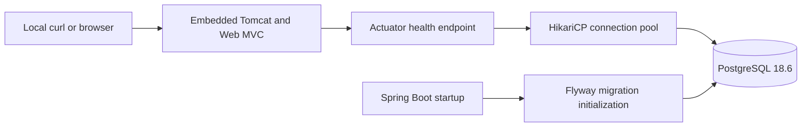

# Architecture

## Implemented: Milestone 1

One JVM process runs Spring Boot with embedded Tomcat, Web MVC, Actuator, JDBC/HikariCP and Flyway. PostgreSQL runs separately in this project's Docker Compose stack. Environment variables supply local connection settings; `application.properties` defines defaults and error/health visibility.

Startup enters `backend/src/main/java/com/punttiurpo/PunttiUrpoApplication.java`. Spring Boot discovers configuration and auto-configures the dependencies on the classpath. JDBC creates a connection pool; Flyway validates migrations and initializes its history table. A database failure during initialization stops startup. There are no versioned SQL migrations yet.

A request to `/actuator/health` goes through Tomcat and Web MVC to Actuator. Its database health contributor checks a connection; the aggregate status is returned without component details. An outage after startup produces HTTP 503, while the JVM stays alive and can recover after database connectivity returns. Bounded connection, validation and socket timeouts prevent an indefinitely stalled check. Probe groups are disabled because this milestone exposes one aggregate health contract, not Kubernetes probes.

No custom controller, service, repository, DTO, mapper or JPA entity exists yet. There is no need to wrap framework health behavior in a bespoke application controller.

## Tests

`backend/src/test/java/com/punttiurpo/FoundationIntegrationTest.java` starts a full application on a random port and a disposable PostgreSQL 18.6 container. Dynamic properties point only that test application at the test database. The tests check real SQL connectivity, Flyway initialization without domain tables, and HTTP health during a database pause and recovery. The Compose volume and personal data are never used by these tests.

## Planned layered architecture

Controllers will translate HTTP input/output using DTOs. Services will implement use cases and transaction boundaries. Repositories will access persistence. Entities will describe JPA mappings; mappers will translate between entities and DTOs where needed. Use constructor injection for application dependencies.

Future flow: HTTP → controller → service → repository → PostgreSQL. Do not create empty layers or generic CRUD abstractions before actual features require them. See [DECISIONS.md](DECISIONS.md) for alternatives and trade-offs.
