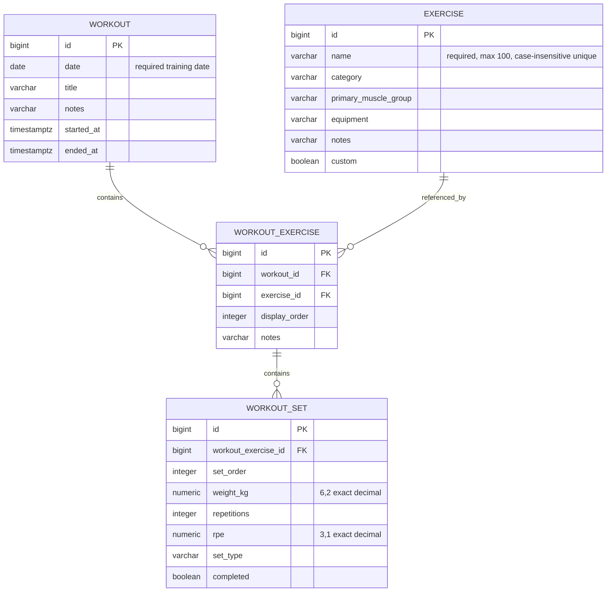

# Database

## Local database and lifecycle

PostgreSQL 18.6 uses this project's `compose.yaml`, dedicated network and `puntti-urpo_postgres_data` volume. Its host port defaults to `127.0.0.1:54328`. The official PostgreSQL 18 image's parent data location `/var/lib/postgresql` is mounted to the volume. Credentials are initialized only for a new volume; editing `.env` later does not update existing database roles.

The backend reads `DB_HOST`, `DB_PORT`, `POSTGRES_DB`, `POSTGRES_USER` and required `POSTGRES_PASSWORD`. Compose reads `.env`; Java requires exporting it separately (README). Stop/start and `docker compose down` preserve data; `docker compose down -v` deletes it. Volume persistence is not a backup. Production backup/restore belongs to Milestone 7.

## Implemented schema: catalogue and workout domain



`id` is the primary key, generated using PostgreSQL `GENERATED ALWAYS AS IDENTITY`. The JPA entity uses a nullable `Long` before insertion and `GenerationType.IDENTITY` to obtain the database-generated ID. `@Column` mappings make sizes and snake_case naming explicit.

The unique expression index `exercise_name_unique` on `lower(name)` prevents case-only duplicates across custom and built-in records, including racing inserts or updates. CHECK constraints reject empty/space-only names and surrounding ordinary spaces. API normalization/Bean Validation additionally handle Java whitespace and input length before persistence. SQL varchar lengths and checks are authoritative database constraints; the API can be stricter. Search uses a parameterized JPQL literal substring (`locate`), so user input cannot become SQL or LIKE wildcards. The small catalogue does not need a trigram/full-text index yet; the uniqueness index is not a substring-search optimization.

`custom=false` marks the ten requested built-in exercises; API creates always set true and updates cannot change this field. The service rejects edits to built-ins. This is application-level catalogue protection, not a database permission system or per-user authorization. Metadata is nullable free text. Workout foreign keys, explicit cascades and logging APIs now exist; Milestone 4 calculates read-only RIR/repetition-based e1RM without changing schema.

## Migrations and JPA validation

- V1 creates the exercise table and name constraints/index.
- V2 records the original eight Finnish seed exercises.
- V3 changes built-ins to exactly Roope's ten requested English names. Bench Press, Barbell Back Squat, Deadlift and Dumbbell Curl keep their equivalent original IDs. Four unused built-ins are removed before workout relationships exist, and six new entries are inserted. Custom exercises are untouched. A case-insensitive collision with an existing custom name fails the migration transaction safely; resolve it deliberately rather than deleting user data.
- V4 creates workout, workout_exercise and workout_set with keys, ordering and performance constraints.

Both files are under `backend/src/main/resources/db/migration/`. Flyway stores applied versions/checksums in `flyway_schema_history`, applies migrations once and validates later starts. Never edit an applied shared migration; add a new version. Clean remains disabled. Hibernate `ddl-auto=validate` checks the mapped table at startup and must never update schema automatically.

Pre-existing databases upgrade by running missing V1–V5 migrations; no volume reset or data deletion is needed. The seed migration is versioned, not a startup routine that overwrites edited data. Future seed corrections require a deliberate migration.

## Transactions and tests

Service reads are `@Transactional(readOnly=true)`. Create/update use write transactions. Updates change a managed entity; Hibernate tracks those changes. Explicit flush makes integrity conflicts surface before returning success. A duplicate update rolls back, preserving the previous values. `spring.jpa.open-in-view=false` keeps database access inside service boundaries.

Unit tests check service policy with repository mocks. Full HTTP integration tests use a separate real PostgreSQL container, clean only their own custom rows between cases, and verify schema/seed application, constraint enforcement and rollback. They never use the Compose volume. The foundation integration suite separately tests database health and migration history.

## Inspection

From the repository root with the database running:

```sh
docker compose exec db sh -c 'exec psql -U "$POSTGRES_USER" -d "$POSTGRES_DB"'
```

Inside psql: `\dt`, `\d exercise`, `SELECT id, name, custom FROM exercise ORDER BY id;`, and `\q`. No password needs printing.

## Workout relationships, ordering and deletion

Each logged exercise references exactly one workout and one catalogue exercise through required lazy `@ManyToOne` mappings. Each set references exactly one logged exercise. Catalogue entries can occur repeatedly in a workout at different display positions. References never move to another parent through PUT.

Foreign keys define deletion explicitly: workout → logged exercise and logged exercise → set use `ON DELETE CASCADE`; catalogue exercise references use `ON DELETE RESTRICT`. Deleting a workout removes only its descendants, while deleting a logged exercise removes only its sets. Other workouts, siblings and catalogue records survive. There is still no catalogue DELETE API.

JPA mappings are unidirectional and have no cascade-remove annotations or parent collections. PostgreSQL performs the child deletion; Hibernate is not asked to load every child and remove it individually. No ORM orphan-removal rule is implied. APIs flush before returning; a failed constraint rolls back the transaction.

`display_order` and `set_order` range from 0 to 1,000,000, unique per immediate parent. Their unique indexes also support the parent foreign-key lookups. New items append at max + 1; sets may specify a position. Gaps after deletion are valid. A move onto an occupied position or racing append returns 409. Atomic batch reorder and automatic retry are not implemented. A separate index supports catalogue references; workout `(date DESC, id DESC)` supports history summaries.

## Performance and temporal storage

`weight_kg` is nullable `numeric(6,2)`, mapped to BigDecimal: 0–9999.99 and at most two decimal places through the API. `rpe` is nullable `numeric(3,1)`, restricted to 6–10 in exact half-point increments. Repetitions are nullable integers in 0–1000. A CHECK requires non-null weight and positive repetitions when completed is true. Draft sets may remain incomplete. Enum set type is stored as WARMUP/WORKING text, never a fragile ordinal.

Bean Validation rejects excess decimal places before database storage. PostgreSQL numeric coercion can round values supplied by direct administrative SQL, so direct writers must honor the same precision contract. There is no binary floating-point conversion in the application. RPE is subjective; Milestone 3 stored these observations; Milestone 4 now derives approximate RIR and repetition-based e1RM without rewriting rows or claiming measured performance.

Training `date` maps to LocalDate independently of server timezone. Optional started/ended timestamps map to Instant and `timestamp with time zone`; the end requires a start and cannot be earlier. PostgreSQL preserves an instant, not the original offset/timezone string. Normal PostgreSQL timestamp precision is microseconds; do not rely on nanosecond round trips.

Nested workout reads load catalogue details with an entity graph and all workout sets in one query, then group sets by logged-exercise ID. The service assembles DTOs inside its transaction with OSIV disabled. Current catalogue names are shown through references; there is no historical name snapshot. Concurrent editing is last successful write wins, with database constraints enforcing integrity; optimistic versioning is not implemented.


## Derived values are not persisted

Milestone 4 adds no migration or column. RIR and repetition-based e1RM are computed from recorded values at response-mapping time. Milestone 4 left the Flyway history at V1–V4; the later Finnish-name update adds V5. There are no caches or formula-version backfills to maintain at this stage. Editing a set changes its derived response immediately. Raw kg/repetitions/RPE/completion stay the source data; unavailable estimates remain null rather than being stored as zero.


## Milestone 5 browser boundary

The frontend adds no migration or database table. V1–V4 remain unchanged. Explicit API saves persist records; unsaved browser input is lost on refresh/navigation if discarded. Browser localStorage holds only the theme, never a copy of workout history. Development UI smoke tests used explicitly named disposable workouts and removed only those records afterward; the existing catalogue/custom records and database volume were preserved.


## Finnish built-in names (V5)

V5 translates the ten English built-ins to Finnish using UPDATE restricted to `custom = false` and the known source names. IDs, workout references and all other fields remain unchanged; custom exercises are untouched. V1–V4 are immutable migration history and must not be edited. If a translated name conflicts with an existing custom name under the case-insensitive unique index, PostgreSQL rolls the entire V5 migration back. Resolve that name conflict deliberately; do not delete or silently rename custom records.

The upgrade test migrates V2 → V4, records a workout/set referencing the existing bench ID, then applies V5. It verifies the Finnish catalogue, stable ID/reference, recorded performance, custom row and repeat-startup behavior. A separate schema tests conflict rollback against real PostgreSQL. There are now five applied migrations and 68 backend tests.


## Two-account ownership and invented demo (V6)

V6 adds `workout.owner_key` (owner/demo, non-null, indexed with history ordering) and `exercise.owner_key`. Every existing workout/custom exercise is backfilled to owner. Built-ins have null owner and remain shared; custom rows require owner ownership. The fixed account keys match the two externally configured Spring Security principals; there is deliberately no account-registration table or user-management API. Credentials/hashes never enter migrations.

One invented completed demo workout is inserted with its own logged exercise/set. This is versioned seed data, not copied personal history and not reset on every startup. Only read access is exposed for demo. Owner cannot read/mutate demo records through domain APIs. Owner-key columns are internal; DTOs do not expose writable ownership.

The application scopes queries before accessing records. Database checks enforce allowed owner values, but PostgreSQL row-level security is not enabled; a raw database administrator can see both scopes. Backups therefore contain both scopes and require private storage. V1–V5 remain immutable and V6 upgrades in place without resetting the volume. See AUTHENTICATION.md for the full access boundary.


## First production deployment

Roope selected an empty production owner account. No local records or custom exercises are copied to the NUC. V1–V6 initialize the independent production volume, with ten Finnish built-ins and the invented demo workout. Verified owner count after disposable smoke-test cleanup is zero; demo count is one. Database restart preserved a saved disposable set before its explicit cleanup. A custom-format backup restored all six migration entries and the demo data into a separate temporary database without overwriting production. Daily local backups are scheduled; off-host disaster-recovery storage remains unconfigured.
